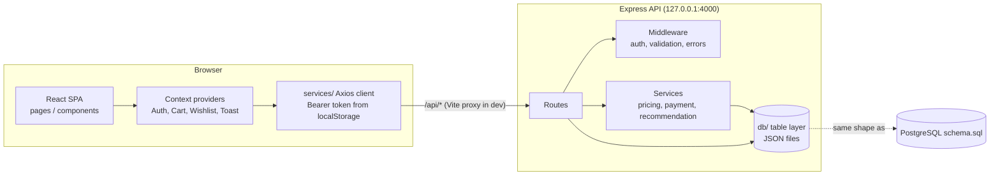
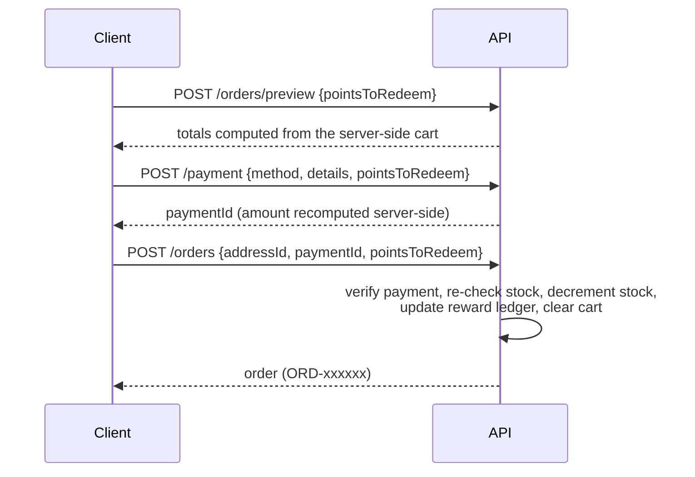

# PageTurner - Full Stack E-Bookstore

A production-style online bookstore: browse, search and filter books, manage a cart and wishlist, check out with
saved addresses and reward points, pay through a **mock** gateway, view order history, **Buy Again**, and get
recommendations. Includes a small admin area. Data lives in local JSON files that mirror a PostgreSQL schema
(`database/schema.sql`) for a mechanical future migration.

## Contents

1. [Tech stack](#tech-stack)
2. [Architecture](#architecture)
3. [Folder structure](#folder-structure)
4. [Setup](#setup) / [Run](#run)
5. [Demo accounts & test data](#demo-accounts--test-data)
6. [API documentation](#api-documentation)
7. [Database](#database)
8. [Testing](#testing)
9. [Security notes](#security-notes)
10. [Git workflow](#git-workflow)
11. [Known limitations](#known-limitations)

## Tech stack

| Layer    | Technology |
|----------|------------|
| Frontend | React 18, Vite, React Router, Context API, Tailwind CSS v4, Axios, React Hook Form, Yup |
| Backend  | Node.js (>= 20.12), Express 5, JWT (HS256), helmet, CORS, express-rate-limit |
| Data     | JSON files in `server/data` (generated by the seed script); PostgreSQL DDL in `database/schema.sql` |
| Testing  | Jest + Supertest (API), Jest + React Testing Library (UI) |

## Architecture



Checkout flow (the server is the source of truth for every amount):



## Folder structure

```
ebookstore/
├── database/schema.sql          PostgreSQL 15+ CREATE TABLE scripts
├── scripts/smoke-test.mjs       Live end-to-end API smoke test
├── server/
│   ├── src/
│   │   ├── config/              env-driven configuration
│   │   ├── db/                  JSON table layer + seed script
│   │   ├── middleware/          auth (JWT), error handler
│   │   ├── routes/              auth, books, cart, wishlist, address, orders, payment, recommendations, admin
│   │   ├── services/            pricing, payment, recommendation
│   │   └── utils/               validate, errors, logger, password (scrypt)
│   ├── data/                    generated JSON "database" (git-ignored)
│   └── tests/                   Supertest suites
└── client/
    ├── public/covers/           generated SVG book covers
    └── src/
        ├── components/          common, books, checkout, orders, layout
        ├── context/             Auth, Cart, Wishlist, Toast
        ├── pages/               Home, Catalog, BookDetails, Cart, Checkout, Payment, OrderSuccess, OrderHistory, Wishlist, Login, admin/
        ├── services/            Axios instance + per-domain API modules
        ├── utils/               format, validators (Yup), receipt
        └── test/                test utilities and mocks
```

## Setup

Requirements: **Node.js >= 20.12** and npm.

```bash
npm install                 # installs both workspaces
cp .env.example server/.env # optional - see below
```

The JSON database and book covers are generated automatically on first server start. To reset them at any time:

```bash
npm run seed
```

### Environment variables (`server/.env`, optional)

| Variable      | Default                   | Purpose |
|---------------|---------------------------|---------|
| `JWT_SECRET`  | random per process        | Signing key. **Set a long random value** (>= 32 chars) or sessions reset on every restart. |
| `PORT`        | `4000`                    | API port |
| `HOST`        | `127.0.0.1`               | Bind address (never `0.0.0.0`) |
| `CORS_ORIGIN` | `http://localhost:5173`   | Allowed browser origin |
| `DB_DIR`      | `server/data`             | Location of the JSON files |

Generate a secret: `node -e "console.log(require('crypto').randomBytes(48).toString('hex'))"`.
`.env` files are git-ignored; never commit secrets.

## Run

Two terminals:

```bash
npm run dev:server    # API  -> http://127.0.0.1:4000
npm run dev:client    # SPA  -> http://127.0.0.1:5173  (proxies /api to the API)
```

Production build of the SPA: `npm run build` (output in `client/dist`).

## Demo accounts & test data

| Role     | Email                | Password   | Notes |
|----------|----------------------|------------|-------|
| Customer | `user@bookstore.com` | `User@1234`| 500 reward points, 1 saved address, 2 past orders |
| Admin    | `admin@bookstore.com`| `Admin@123`| Access to `/admin` |

These are **demo-only** credentials seeded into local JSON. Change them before any real deployment.

Payment test values (mock gateway; nothing is charged, PAN/CVV are never stored):

| Method      | Input |
|-------------|-------|
| Card        | `4242 4242 4242 4242`, any future expiry (`MM/YY`), CVV `123` |
| Declined    | `4000 0000 0000 0002` |
| UPI         | any `name@bank` |
| Net Banking / Wallet | choose any listed option |

## API documentation

Base URL: `/api`. JSON in/out. Authenticated routes need `Authorization: Bearer <token>`.
Errors: `{ "error": "message", "details": { "field": "reason" } }` (`details` only for validation errors).

### Auth
| Method | Path | Auth | Description |
|--------|------|------|-------------|
| POST | `/auth/login` | - | `{email, password, remember?}` -> `{token, user}`. Rate limited. `remember` extends the token to 7 days (default 2h). |
| GET  | `/auth/user` | yes | Current user (includes `rewardPoints`) |
| POST | `/auth/logout` | yes | Revokes the token |

### Books & categories
| Method | Path | Description |
|--------|------|-------------|
| GET | `/books` | Query: `search, category, author, publisher` (comma-separated), `rating`, `minPrice`, `maxPrice`, `sort` (`price_asc`, `price_desc`, `rating`, `newest`), `featured`, `bestseller`, `page`, `limit` (max 48). Returns `{items, page, limit, total, totalPages}` |
| GET | `/books/search?q=` | Top 10 instant-search matches (title, author, publisher, category, ISBN) |
| GET | `/books/facets` | Categories, authors, publishers and price range for filters |
| GET | `/books/category/:category` | By category name, slug or id |
| GET | `/books/:id` | `{book, related, frequentlyBoughtTogether}`; records a view for signed-in users |
| GET | `/categories` | Categories with book counts |
| GET | `/recommendations` | "Recommended for you" (purchase history + viewed categories); popular books for guests |
| GET | `/recommendations/similar/:bookId` | Similar books |

### Cart (auth)
| Method | Path | Description |
|--------|------|-------------|
| GET | `/cart` | `{items, summary:{quantity, subtotal, tax, total}}` |
| POST | `/cart` | `{bookId, quantity?}` (max 10, limited by stock) |
| PUT | `/cart/:id` | `{quantity?, savedForLater?}` |
| DELETE | `/cart/:id` | Remove one item |
| DELETE | `/cart` | Clear cart |
| POST | `/cart/rebuy/:orderId` | **Buy Again** - replaces the cart with the order's items; returns `skipped` titles that are unavailable |

### Wishlist (auth)
`GET /wishlist` · `POST /wishlist {bookId}` · `DELETE /wishlist/:bookId` · `POST /wishlist/:bookId/move-to-cart`

### Addresses (auth)
`GET /address` · `POST /address` · `PUT /address/:id` · `PUT /address/:id/default` · `DELETE /address/:id`
Fields: `fullName, phone (10-digit Indian mobile), houseNumber, street, city, state, country, pincode (6 digits), isDefault?`.

### Orders & payment (auth)
| Method | Path | Description |
|--------|------|-------------|
| POST | `/orders/preview` | `{pointsToRedeem?}` -> totals, discount, payable, points to earn |
| POST | `/payment` | `{method, details, pointsToRedeem?}`. `method`: `credit_card, debit_card, upi, net_banking, wallet`. 201 on success, 400 invalid details, 402 declined |
| POST | `/orders` | `{addressId, paymentId, pointsToRedeem?}` -> creates the order. A payment can be used once |
| GET | `/orders` | Order history, newest first |
| GET | `/orders/:id` | Order details |

### Admin (admin role)
`GET /admin/stats` · `GET /admin/books` · `POST /admin/books` · `PUT /admin/books/:id` · `DELETE /admin/books/:id`

### Pricing rules
Tax 5% of subtotal. 1 reward point = 1 INR discount (cannot exceed the order total or the user's balance).
Users earn 1 point per 100 INR paid. Saved-for-later items are excluded from totals.

## Database

* **Runtime**: `server/data/*.json` (`users, books, categories, orders, addresses, cart, wishlist, payments, rewardPoints, views`).
  Passwords are stored as salted scrypt hashes, not plaintext.
* **PostgreSQL**: `database/schema.sql` defines `users, categories, books, addresses, cart_items, wishlists, book_views,
  payments, orders, order_items, reward_points` with enums, constraints, indexes (including full-text search and a
  one-default-address-per-user partial unique index) and `updated_at` triggers.

```bash
createdb ebookstore && psql -d ebookstore -f database/schema.sql
```

Migration path: replace `server/src/db/index.js` (a thin table abstraction: `all/find/where/insert/update/remove`) with a
`pg`-backed implementation using parameterised queries. Orders embed `items` and an address snapshot in JSON; in SQL these
become `order_items` rows and `orders.address_snapshot`.

## Testing

```bash
npm run test          # server (Jest + Supertest) then client (Jest + RTL)
npm run test -w server
npm run test -w client
```

Coverage areas: login, search/filter/sort, cart, address CRUD, checkout + reward points, payment validation (Luhn, expiry,
CVV, UPI, bank, wallet), order placement, order history, Buy Again, recommendations, admin CRUD, authorization.

**Live smoke test** (with API and client running):

```bash
node scripts/smoke-test.mjs http://127.0.0.1:5173
```

It walks the whole purchase journey (login -> browse -> cart -> address -> payment -> order -> Buy Again -> admin -> logout)
through the Vite proxy. It creates and then removes its own test address and test book, but it **does place a real order and
consumes stock/points in the local JSON data**; run `npm run seed` to reset.

## Security notes

* Passwords hashed with scrypt; constant-time comparison; identical error for unknown user vs. wrong password.
* JWT (HS256) with expiry and server-side revocation on logout (in-memory list - use Redis when running multiple instances).
* Server binds to `127.0.0.1`; helmet headers; CORS restricted to one origin; JSON body limit 50 KB; rate limits on login and payment.
* Allow-list input validation on every write endpoint; generic 500 messages; structured logs without PII or secrets.
* Payment amounts are always recomputed on the server; card numbers/CVV are never persisted (only a masked reference).
* Demo-only: the session token is stored in `localStorage` (as requested). For production prefer `httpOnly; Secure; SameSite` cookies.
* Run `npm audit` regularly. At last check production dependencies reported 0 vulnerabilities.

## Git workflow

Trunk-based with short-lived feature branches merged into `main` (`--no-ff`):

```
main
├── feature/backend-api         feat: add Express API ...
├── feature/frontend-app        feat: implement authentication, catalog, cart, checkout, payment, orders
├── feature/testing             test: add client component and flow tests
└── feature/docs-and-tooling    docs: add README, smoke test
```

Conventional commit prefixes: `feat:`, `fix:`, `test:`, `docs:`, `chore:`, `refactor:`.

## Known limitations

* No real payment processing, email, or real inventory reservation; stock is decremented at order time only.
* JSON storage is single-process and not safe for concurrent writers; use PostgreSQL for anything beyond a demo.
* Receipt download is a plain-text file, not a PDF.
* Product images are generated SVG covers.
